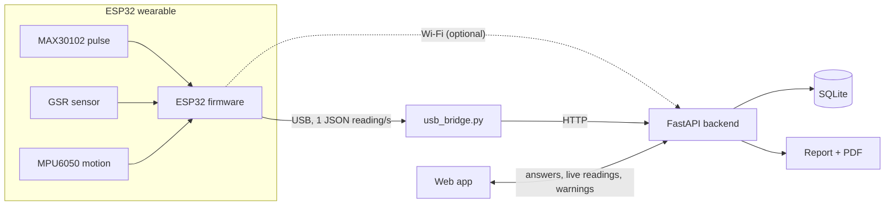

# ErgoCare AI

**Posture and stress screening that combines what people *say* with what their *body shows*.**

ErgoCare pairs a 40-question ergonomic assessment (typed or spoken, in **English, हिन्दी or ಕನ್ನಡ**) with a low-cost ESP32 wearable that measures **heart rate, skin response (a stress signal) and posture** while the person answers. Both are combined into one report — the **ErgoCare Index** — that also flags where answers and body disagree, e.g. *"You reported low stress, but your body showed stress responses for 48% of the session."*

> ErgoCare is a **screening tool, not a medical diagnosis.**

| Connect the wearable | Live posture warning |
|---|---|
|  |  |
| **Report: body signals + ErgoCare Index** | **Questions in Kannada, voice understood** |
|  |  |

---

## What it does

| | Feature |
|---|---|
| 🧍 | **Live posture tracking** — forward lean measured by an MPU6050 on the collar; on-screen warning after 10 s of slouching |
| 💧 | **Stress from the body** — skin response (GSR) and heart rate (MAX30102) compared with *your own* 60-second resting baseline |
| 📝 | **40-question assessment** across workload, eyes, posture, movement, pain and recovery — typed or spoken |
| 🗣 | **Understands spoken answers** — "my eyes are really tired by evening" → *Very tired*, shown as "Understood as…" for the person to confirm |
| 🌐 | **English, Hindi, Kannada** — questions, options and voice input |
| ⭐ | **ErgoCare Index** = 60% questionnaire + 40% body signals, plus **Hidden stress** / **Posture blind spot** insights |
| 📄 | **Report and PDF** with heart-rate, skin-response and posture graphs |
| 🔐 | **Consent, admin login, CSV export** for college health centres / camps |

## How it works



1. **Connect** — the app finds the wearable and checks finger / electrode / sensor contact.
2. **60-second baseline** — resting heart rate and skin response are recorded; the current posture becomes "upright".
3. **Questions** — answers are saved one by one while a live panel shows heart rate, stress level and posture; warnings pop up on screen.
4. **Report** — questionnaire scores, body-signal scores, the ErgoCare Index, insights, graphs and a PDF.

### Scoring (transparent rules — every number can be explained)

| Score | Rule |
|---|---|
| Posture | 70% × share of time leaning > 20° + 30% × average lean (30° = 100) |
| Stress | share of time at *high* stress + ½ × share at *elevated* (GSR +15% / +30%, or heart rate +10 / +20 BPM above your baseline) |
| Stillness | longest time without moving (20 min = 100) |
| Body-signal score | 50% posture + 40% stress + 10% stillness |
| **ErgoCare Index** | **60% questionnaire + 40% body-signal score** |

The questionnaire score and all thresholds are hand-set expert rules (see `ergo_ml_backend/app/domain/`), not a trained model. The machine-learning part is the answer matcher (next section).

### Understanding free-form answers

Spoken answers rarely match an option word-for-word. A layered matcher (`app/domain/answer_matcher.py`) uses rules (numbers, yes/no, quantities, frequency and intensity words, Hindi/Kannada keyword glossary) and a **MiniLM sentence-embedding model** (via FastEmbed/ONNX, runs locally, ~90 MB). Measured with `scripts/eval_matcher.py`:

| Test set | Old exact-match | Rules only | Rules + MiniLM |
|---|---|---|---|
| Development (50 English answers) | 0% | 94% | 100% |
| **Held-out (20 new English answers)** | 0% | 85% | **85%** |

The held-out score was 70% before three general fixes it prompted, so **70–85% is the honest range** on unseen phrasing — which is why the person always confirms the option on screen.

---

## Quick start (Windows)

**Needs:** Python 3.10+, Node.js 18+, Chrome or Edge, Arduino IDE (for the ESP32).

```bat
REM 1. Backend
cd ergo_ml_backend
python -m venv .venv
.venv\Scripts\pip install -r requirements.txt pyserial
copy .env.example .env
REM    edit .env: set ADMIN_USERNAME, ADMIN_PASSWORD (long, random) and ADMIN_SECRET
cd ..

REM 2. Web app
npm install

REM 3. Run everything (backend + app + wearable) and open the browser
start_demo.bat          &REM with the ESP32 plugged in via USB
start_demo.bat demo     &REM DEMO MODE: simulated wearable "DEMO-01" (no hardware)
```

Then open **http://localhost:5173**. Everything runs on the laptop — no Wi-Fi needed (Chrome's voice recognition does need internet; typing works offline).

<details>
<summary>Running the parts by hand</summary>

```bat
REM backend (must run inside ergo_ml_backend)
cd ergo_ml_backend && .venv\Scripts\python -m uvicorn app.main:app --port 8000
REM web app
npm run dev
REM wearable over USB (or demo_simulator.py instead)
ergo_ml_backend\.venv\Scripts\python firmware\usb_bridge.py
```
API docs: http://127.0.0.1:8000/docs
</details>

### Flashing the ESP32

1. Arduino IDE → board **ESP32 Dev Module**; library **SparkFun MAX3010x Pulse and Proximity Sensor**.
2. Open `firmware/ergocare_wearable/ergocare_wearable.ino` and upload.
3. Check the sensors: `ergo_ml_backend\.venv\Scripts\python firmware\serial_monitor.py`

Wi-Fi is optional: copy `secrets.example.h` to `secrets.h` (git-ignored) and fill in a 2.4 GHz network and the laptop's address.

## Hardware

| Part | Purpose | Approx. cost* |
|---|---|---|
| ESP32 DevKit (CP2102 USB) | microcontroller | ₹350–450 |
| MAX30102 / HW-058 | pulse (heart rate) | ₹150–250 |
| MPU6050 | posture tilt + movement | ₹150–200 |
| GSR module + finger electrodes | skin response (stress) | ₹300–600 |
| Wires, band, clip | mounting | ₹100–200 |
| **Total** | | **≈ ₹1,000–1,700** |

*Approximate Indian retail prices — replace with your actual bill of materials.

| Sensor pin | ESP32 pin |
|---|---|
| MAX30102 VIN / GND / SDA / SCL | 3V3 / GND / GPIO21 / GPIO22 (I²C 0x57) |
| MPU6050 VCC / GND / SDA / SCL | 3V3 / GND / GPIO21 / GPIO22 (I²C 0x68, shared bus) |
| GSR VCC / GND / SIG | 3V3 / GND / GPIO34 (ADC1 — works with Wi-Fi on) |

Power the GSR module from **3.3 V** so its output never exceeds the ESP32's 3.3 V input. Wear the MPU6050 on the back of the collar / upper back, a fingertip on the MAX30102, and the GSR electrodes on two fingers of the other hand.

## Checking it works

```bat
cd ergo_ml_backend
.venv\Scripts\python scripts\verify_wearable.py     &REM logic + scoring + live wearable checks (PASS/FAIL)
.venv\Scripts\python scripts\eval_matcher.py        &REM answer-matcher accuracy
```

## Privacy and security

- **Consent is required** (enforced by the server) and recorded with its version and time; the form explains what is stored and why.
- **Admin access** uses a server-side login (`ADMIN_USERNAME` / `ADMIN_PASSWORD` in `.env` or the hosting dashboard) with expiring tokens and lock-out after 5 failed attempts. No passwords or tokens are in the web page.
- Admins can delete a person's data (answers, audio, sensor readings, consent) on request.
- `.env`, the database, audio uploads, Wi-Fi secrets and downloaded models are git-ignored.

## Deploying

- **Backend (Render):** `render.yaml` — set `ADMIN_USERNAME` and `ADMIN_PASSWORD` in the dashboard (`ADMIN_SECRET` is generated); set `ALLOWED_ORIGINS` to the web app's URL.
- **Web app (Vercel):** `npm run build`; set `VITE_API_BASE` to the backend URL.

## Project structure

```
index.html                 web app (screens, live panel, report, admin)
public/i18n.js             Hindi + Kannada text
public/vendor/             Chart.js, Three.js (served locally - works offline)
start_demo.bat             one-click start (add "demo" for the simulator)
firmware/                  ESP32 firmware, USB bridge, demo simulator, serial monitor
ergo_ml_backend/app/
  api/routes/              sessions, answers, reports (PDF), sensors, questions, admin
  domain/                  scoring, wearable scoring, answer matcher, Hindi/Kannada glossary
  models/                  database tables
ergo_ml_backend/scripts/   verify_wearable.py, eval_matcher.py
```

## Limitations and next steps

- Low-cost sensors, not medical devices; thresholds are sensible defaults, **not yet validated** against clinical measurements. Next: a pilot comparing ErgoCare with physiotherapist assessments.
- Scoring rules are hand-set; a trained model needs labelled outcome data from a larger pilot.
- Hindi/Kannada translations need native-speaker review; results page and PDF are English only.
- Voice recognition uses the browser (needs internet); on-device speech recognition is future work.
