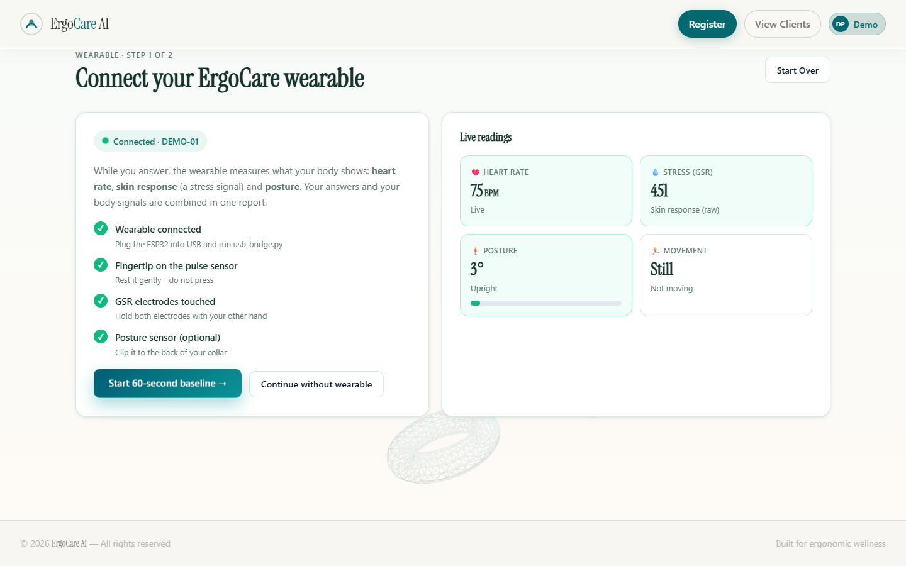
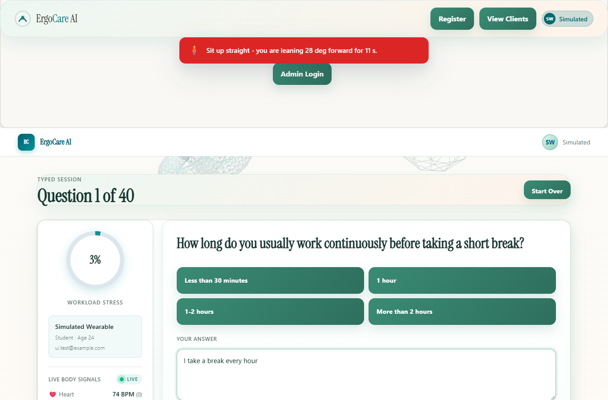
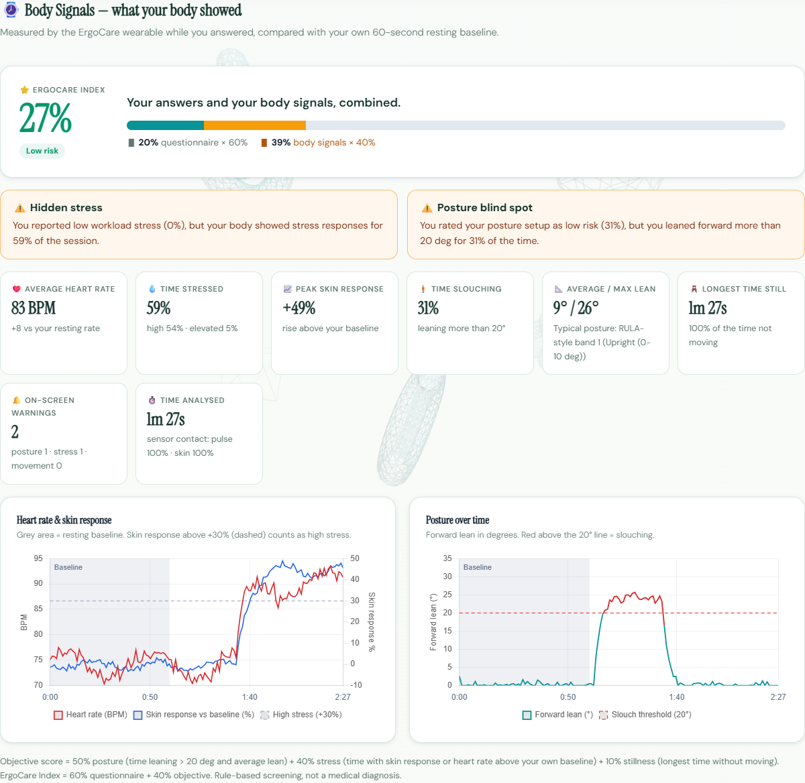
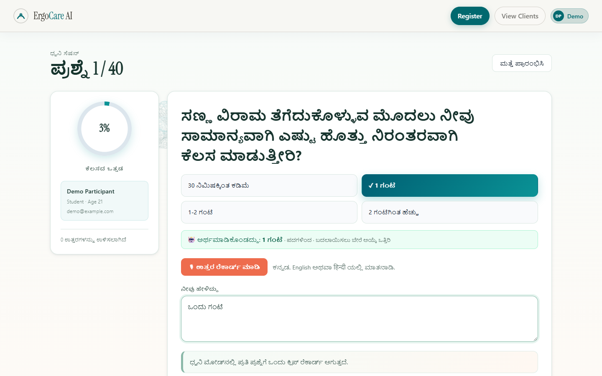
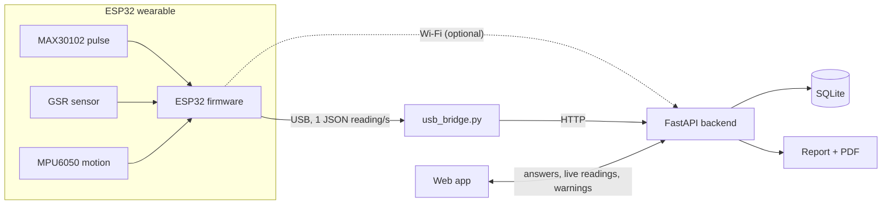

# ErgoCare AI

**Posture and stress screening that combines what people *say* with what their *body shows*.**

ErgoCare pairs a 40-question ergonomic assessment (typed or spoken, in **English, हिन्दी or ಕನ್ನಡ**) with a low-cost ESP32 wearable that measures **heart rate, skin response (a stress signal) and posture** while the person answers. Both are combined into one report — the **ErgoCare Index** — that also flags where answers and body disagree, e.g. *"You reported low stress, but your body showed stress responses for 48% of the session."*

> ErgoCare is a **screening tool, not a medical diagnosis.**

**Team Upright** — Harshdeep Sharma (Team Lead · Hardware & Firmware) · Alex Jilson (Backend & AI) · Shrayana KS (Frontend, UX & Languages)

| Document | What's in it |
|---|---|
| [Setup](#setup) · [Environment variables](#environment-variables) | Install and run on a laptop, every setting explained |
| [Technical Design Document](docs/TECHNICAL_DESIGN.md) | Architecture diagrams, API, data model, scoring rules, AI matcher, security |
| [Test cases and results](docs/TEST_CASES.md) | 9 automated suites + end-to-end replay, incl. **500-answer** and **500-participant** tests |
| [Sample data](sample_data/README.md) | Simulated wearable session, answer sets, 100 voice-answer test cases |
| [LICENSE](LICENSE) · [Third-party notices](THIRD_PARTY_NOTICES.md) | MIT |

| Connect the wearable | Live posture warning |
|---|---|
|  |  |
| **Report: body signals + ErgoCare Index** | **Questions in Kannada, voice understood** |
|  |  |

---

## What it does

| | Feature |
|---|---|
| 🧍 | **Live posture tracking** — forward lean measured by an MPU6050 on the collar; on-screen warning after 10 s of slouching |
| 💧 | **Stress from the body** — skin response (GSR) and heart rate (MAX30102) compared with *your own* 60-second resting baseline |
| 📝 | **40-question assessment** across workload, eyes, posture, movement, pain and recovery — typed or spoken |
| 🗣 | **Understands spoken answers** — "my eyes are really tired by evening" → *Very tired*, shown as "Understood as…" for the person to confirm |
| 🌐 | **English, Hindi, Kannada** — questions, options and voice input |
| ⭐ | **ErgoCare Index** = 60% questionnaire + 40% body signals, plus **Hidden stress** / **Posture blind spot** insights |
| 📄 | **Report and PDF** with heart-rate, skin-response and posture graphs |
| 🔐 | **Consent, admin login, CSV export** for college health centres / camps |

## How it works



1. **Connect** — the app finds the wearable and checks finger / electrode / sensor contact.
2. **60-second baseline** — resting heart rate and skin response are recorded; the current posture becomes "upright".
3. **Questions** — answers are saved one by one while a live panel shows heart rate, stress level and posture; warnings pop up on screen.
4. **Report** — questionnaire scores, body-signal scores, the ErgoCare Index, insights, graphs and a PDF.

### Scoring (transparent rules — every number can be explained)

| Score | Rule |
|---|---|
| Posture | 70% × share of time leaning > 20° + 30% × average lean (30° = 100) |
| Stress | share of time at *high* stress + ½ × share at *elevated* (GSR +15% / +30%, or heart rate +10 / +20 BPM above your baseline) |
| Stillness | longest time without moving (20 min = 100) |
| Body-signal score | 50% posture + 40% stress + 10% stillness |
| **ErgoCare Index** | **60% questionnaire + 40% body-signal score** |

The questionnaire score and all thresholds are hand-set expert rules (see `ergo_ml_backend/app/domain/`), not a trained model. The machine-learning part is the answer matcher (next section).

### Understanding free-form answers

Spoken answers rarely match an option word-for-word. A layered matcher (`app/domain/answer_matcher.py`) uses rules (numbers, yes/no, quantities, frequency and intensity words, Hindi/Kannada keyword glossary) and a **MiniLM sentence-embedding model** (via FastEmbed/ONNX, runs locally, ~90 MB). Measured with `scripts/eval_matcher.py`:

| Test set | Old exact-match | Rules only | Rules + MiniLM |
|---|---|---|---|
| Development (50 English answers) | 0% | 94% | 96% |
| Held-out (20 English answers) | 0% | 100% | 100% |
| Hindi / Kannada (30 answers, own script and romanised, e.g. "Ek Ghanta") | 0% | 100% | — (rules + glossary only) |
| **500 answers** — English, Hindi, Kannada, script + romanised ([details](docs/TEST_CASES.md#500-sample-tests)) | — | — | **98.4%** (first run before fixes: 87.8%) |

The held-out set scored 70%, then 85%, the first times it was run; the general fixes it prompted brought it to 100%, so it is no longer truly unseen. **70–85% is the honest range** on new phrasing until a fresh test set is collected — which is why the person always confirms the option on screen.

---

## Setup

**Needs:** Python 3.10+, Node.js 18+, Chrome or Edge, and the Arduino IDE only if you flash the ESP32. No hardware? Use demo mode (step 4).

**1. Get the code**
```bat
git clone <this-repository-url>
cd ErgoCare
```

**2. Backend (FastAPI)**
```bat
cd ergo_ml_backend
python -m venv .venv
.venv\Scripts\pip install -r requirements.txt pyserial
copy .env.example .env
REM edit .env - at least ADMIN_USERNAME, ADMIN_PASSWORD (long, random) and ADMIN_SECRET
REM optional: DEVICE_INGEST_TOKEN  (python -c "import secrets; print(secrets.token_urlsafe(32))")
cd ..
```
macOS / Linux: `python3 -m venv .venv`, `.venv/bin/pip install -r requirements.txt pyserial`, `cp .env.example .env`.

**3. Web app**
```bat
npm install
```

**4. Run everything (Windows, one click)**
```bat
start_demo.bat          &REM ESP32 plugged in via USB
start_demo.bat demo     &REM DEMO MODE: simulated wearable "DEMO-01", no hardware
```
It opens three windows (backend, web app, wearable) and then **http://localhost:5173**. Everything runs on the laptop — no Wi-Fi needed (the browser's voice recognition does need internet; typing works offline). On its first start the backend downloads the ~90 MB answer-matcher model in the background (internet needed once; until then matching uses the rules only).

**5. Check it works** — `cd ergo_ml_backend` then `.venv\Scripts\python scripts\verify_scoring.py` (expects `27/27`). Full list: [docs/TEST_CASES.md](docs/TEST_CASES.md).

<details>
<summary>Running the parts by hand</summary>

```bat
REM backend (must run inside ergo_ml_backend)
cd ergo_ml_backend && .venv\Scripts\python -m uvicorn app.main:app --port 8000
REM web app
npm run dev
REM wearable over USB (or demo_simulator.py instead)
ergo_ml_backend\.venv\Scripts\python firmware\usb_bridge.py
```
API docs: http://127.0.0.1:8000/docs
</details>

## Environment variables

**Backend** — `ergo_ml_backend/.env` (copy from [`.env.example`](ergo_ml_backend/.env.example)). Real environment variables win over the file, so on Render the dashboard values are used.

| Variable | Required? | Default | What it does |
|---|---|---|---|
| `ADMIN_USERNAME` | yes | `admin` | Admin login name |
| `ADMIN_PASSWORD` | yes* | — (admin login disabled) | Admin password. *Or set `ADMIN_PASSWORD_HASH` instead |
| `ADMIN_PASSWORD_HASH` | no | — | PBKDF2 hash `pbkdf2_sha256$<iterations>$<salt_hex>$<hash_hex>`; takes precedence over `ADMIN_PASSWORD` |
| `ADMIN_SECRET` | recommended | random at each start (logins reset on restart) | Signs admin login tokens |
| `ADMIN_TOKEN_HOURS` | no | `8` | How long an admin login stays valid |
| `ADMIN_API_TOKEN` | no | — (disabled) | Static token for scripts (`X-Admin-Token` header) |
| `DEVICE_INGEST_TOKEN` | **yes on any network** | — (ingest open) | Secret the wearable sends as `X-Device-Token`; must equal `DEVICE_TOKEN` in the firmware's `secrets.h`. `usb_bridge.py` and `demo_simulator.py` read it from `.env` automatically |
| `ALLOWED_ORIGINS` | **yes in production** | local dev origins (`localhost:5173`, `:4173`, `:8000`) | Comma-separated web app origins allowed by CORS; `*` is refused; the server will not start on Render without it |
| `DATABASE_URL` | no | `sqlite:///./ergocare.db` | Database (Postgres needs a driver, e.g. `psycopg2-binary`) |
| `AUDIO_UPLOAD_DIR` | no | `./uploads/audio` | Where voice clips are stored |
| `MAX_AUDIO_MB` | no | `10` | Largest voice clip accepted |
| `MIN_FREE_MB` | no | `500` | Uploads refused when free disk space is below this |
| `SENSOR_RETENTION_S` | no | `21600` (6 h) | Wearable readings older than this are deleted; `0` keeps everything |
| `MATCHER_MODEL` | no | `sentence-transformers/all-MiniLM-L6-v2` | Sentence-embedding model for the answer matcher |
| `MATCHER_CACHE_DIR` | no | `ergo_ml_backend/models_cache` | Where the model is downloaded |
| `RENDER` / `PRODUCTION` | set by host | — | When set, `ALLOWED_ORIGINS` becomes mandatory |

**Web app** — `.env` in the project root (copy from [`.env.example`](.env.example)), or the Vercel dashboard:

| Variable | Default | What it does |
|---|---|---|
| `VITE_API_BASE` | `http://127.0.0.1:8000` | URL of the backend, baked in at build time |

**Wearable** — `firmware/ergocare_wearable/secrets.h` (copy from `secrets.example.h`, git-ignored; only needed for Wi-Fi or a device token):

| Setting | What it does |
|---|---|
| `WIFI_SSID`, `WIFI_PASSWORD` | 2.4 GHz network (leave empty for USB-only) |
| `BACKEND_URL` | Laptop/backend address, e.g. `http://192.168.1.20:8000` |
| `DEVICE_ID` | Device name shown in the app (default `ERGO-01`) |
| `DEVICE_TOKEN` | Same value as the backend's `DEVICE_INGEST_TOKEN` |

### Flashing the ESP32

1. Arduino IDE → board **ESP32 Dev Module**; library **SparkFun MAX3010x Pulse and Proximity Sensor**.
2. Open `firmware/ergocare_wearable/ergocare_wearable.ino` and upload.
3. Check the sensors: `ergo_ml_backend\.venv\Scripts\python firmware\serial_monitor.py`

Wi-Fi is optional: copy `secrets.example.h` to `secrets.h` (git-ignored) and fill in a 2.4 GHz network and the laptop's address.

## Hardware

| Part | Purpose | Approx. cost* |
|---|---|---|
| ESP32 DevKit (CP2102 USB) | microcontroller | ₹350–450 |
| MAX30102 / HW-058 | pulse (heart rate) | ₹150–250 |
| MPU6050 | posture tilt + movement | ₹150–200 |
| GSR module + finger electrodes | skin response (stress) | ₹300–600 |
| Wires, band, clip | mounting | ₹100–200 |
| **Total** | | **≈ ₹1,000–1,700** |

*Approximate Indian retail prices — replace with your actual bill of materials.

| Sensor pin | ESP32 pin |
|---|---|
| MAX30102 VIN / GND / SDA / SCL | 3V3 / GND / GPIO21 / GPIO22 (I²C 0x57) |
| MPU6050 VCC / GND / SDA / SCL | 3V3 / GND / GPIO21 / GPIO22 (I²C 0x68, shared bus) |
| GSR VCC / GND / SIG | 3V3 / GND / GPIO34 (ADC1 — works with Wi-Fi on) |

Power the GSR module from **3.3 V** so its output never exceeds the ESP32's 3.3 V input. Wear the MPU6050 on the back of the collar / upper back, a fingertip on the MAX30102, and the GSR electrodes on two fingers of the other hand.

## Testing

Latest results (26 Oct 2026) — details and how to run each one in [docs/TEST_CASES.md](docs/TEST_CASES.md):

| Suite | Result |
|---|---|
| `verify_scoring.py` — scoring rules | 27 / 27 |
| `verify_frontend_parity.py` — web app scores = server scores | 206 / 206 values match |
| `verify_sensor_security.py` — wearable security, data integrity | 36 / 36 |
| `verify_pdf_indic.py` — Hindi + Kannada in the PDF | pass |
| `smoke_wearable.py` — full wearable session over HTTP | 30 / 30 |
| `eval_matcher.py` — AI answer matcher | 48/50 English · 20/20 held-out · 30/30 Hindi/Kannada |
| `eval_matcher_500.py` — **500** answers in 3 languages | 492/500 (98.4%) · first run 439/500 (87.8%) |
| `eval_500_participants.py` — **500** simulated participants through the scoring engine | 500/500 pass all rule checks · detection 100% on clear cases |
| `verify_wearable.py` — live band checks | 22 / 23 without the band (only "band is sending" fails) |
| `sample_data/run_sample_session.py` — end-to-end replay of the sample data | 16 / 16 |

## Privacy and security

- **Consent is required** (enforced by the server) and recorded with its version and time; the form explains what is stored and why.
- **Admin access** uses a server-side login (`ADMIN_USERNAME` / `ADMIN_PASSWORD` in `.env` or the hosting dashboard) with expiring tokens and lock-out after 5 failed attempts. No passwords or tokens are in the web page.
- Admins can delete a person's data (answers, audio, sensor readings, consent) on request.
- `.env`, the database, audio uploads, Wi-Fi secrets and downloaded models are git-ignored.

## Deploying

- **Backend (Render):** `render.yaml` — set `ADMIN_USERNAME`, `ADMIN_PASSWORD` and `DEVICE_INGEST_TOKEN` in the dashboard (`ADMIN_SECRET` is generated); set `ALLOWED_ORIGINS` to the web app's URL.
- **Web app (Vercel):** `npm run build`; set `VITE_API_BASE` to the backend URL.

## Project structure

```
index.html                 web app (screens, live panel, report, admin)
public/i18n.js             Hindi + Kannada text
public/vendor/             Chart.js, Three.js (served locally - works offline)
start_demo.bat             one-click start (add "demo" for the simulator)
firmware/                  ESP32 firmware, USB bridge, demo simulator, serial monitor
ergo_ml_backend/app/
  api/routes/              sessions, answers, reports (PDF), sensors, questions, admin
  domain/                  scoring, wearable scoring, answer matcher, Hindi/Kannada glossary
  models/                  database tables
ergo_ml_backend/scripts/   test suites (verify_*.py, smoke_wearable.py, eval_matcher.py)
sample_data/               sample wearable session, answer sets, voice test cases, replay test
docs/                      TECHNICAL_DESIGN.md, TEST_CASES.md, submission kit, screenshots
```

## Limitations and next steps

- Low-cost sensors, not medical devices; thresholds are sensible defaults, **not yet validated** against clinical measurements. Next: a pilot comparing ErgoCare with physiotherapist assessments.
- Scoring rules are hand-set; a trained model needs labelled outcome data from a larger pilot.
- Hindi/Kannada translations need native-speaker review; results page and PDF are English only.
- Voice recognition uses the browser (needs internet); on-device speech recognition is future work.

## License

ErgoCare's code is released under the [MIT License](LICENSE) © 2026 Team Upright. Bundled libraries and fonts keep their own licenses — see [THIRD_PARTY_NOTICES.md](THIRD_PARTY_NOTICES.md).
