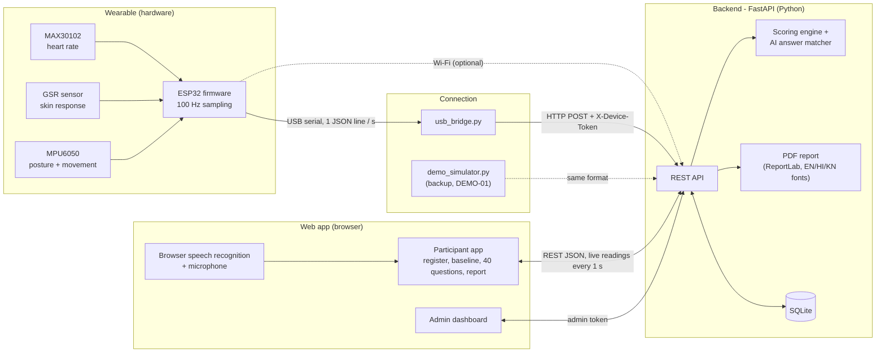
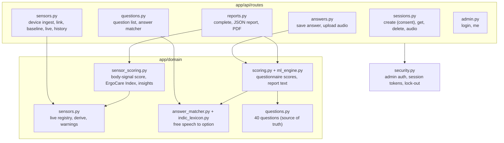
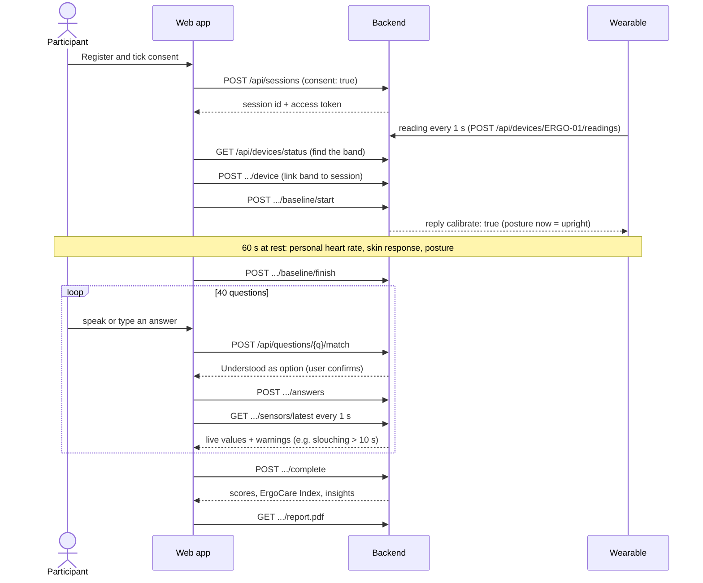
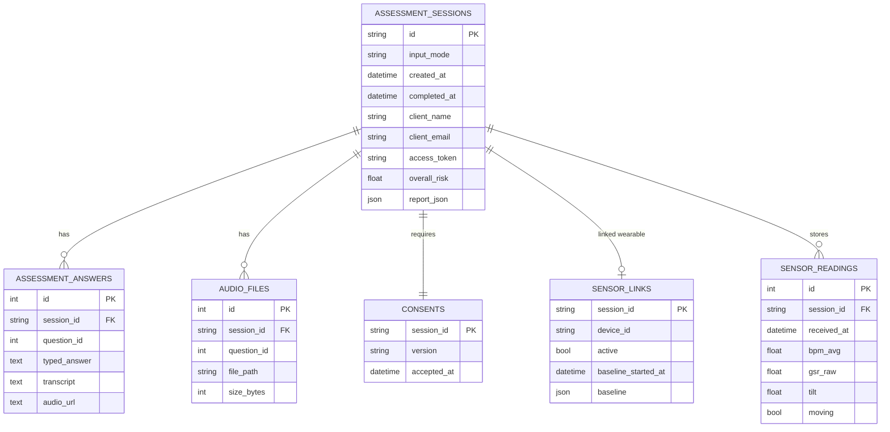
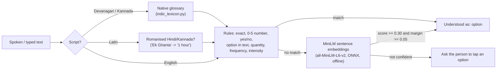
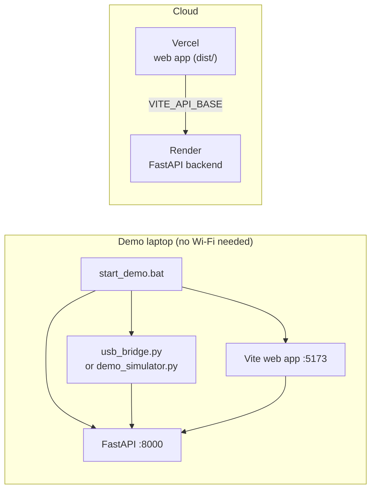

# ErgoCare AI — Technical Design Document

**Team Upright** · Harshdeep Sharma (Team Lead · Hardware & Firmware) · Alex Jilson (Backend & AI) · Shrayana KS (Frontend, UX & Languages)
Hack for Social Cause · VBYLD 2027 · Theme: *Healthcare, Wellbeing & Service Delivery*

> ErgoCare is a **screening tool, not a medical diagnosis**. All thresholds below are prototype defaults that have not been clinically validated.

---

## 1. Purpose and scope

ErgoCare screens students and desk workers for posture- and stress-related strain by combining two sources:

| Source | What it captures | How |
|---|---|---|
| **What people say** | 40 questions on workload, eyes, posture, movement, pain and recovery | Typed or spoken, in English, हिन्दी or ಕನ್ನಡ |
| **What the body shows** | Heart rate, skin response (a stress signal), posture and movement | Low-cost ESP32 wearable, 1 reading per second |

Both are merged into one **ErgoCare Index** and a report (web page + PDF) that also points out where answers and body **disagree** — e.g. *"You reported low stress, but your body showed stress responses for 40% of the session."*

---

## 2. System architecture

*All diagrams in this document are also saved as high-resolution PNGs in [`docs/diagrams/`](diagrams/) for slides.*

| Layer | Technology | Code |
|---|---|---|
| Wearable | ESP32 DevKit, MAX30102, MPU6050, GSR module (Arduino C++) | `firmware/ergocare_wearable/` |
| Connection | Python + pyserial; optional Wi-Fi direct from the ESP32 | `firmware/usb_bridge.py`, `firmware/demo_simulator.py` |
| Backend | FastAPI 0.115, SQLAlchemy 2.0, Pydantic 2, ReportLab 4, FastEmbed 0.8 (ONNX) | `ergo_ml_backend/app/` |
| Database | SQLite by default; Postgres via `DATABASE_URL` once a driver (e.g. `psycopg2-binary`) is installed | `ergo_ml_backend/app/models/` |
| Web app | Single-page HTML/JS served by Vite 8; Chart.js 4.4 and Three.js r128 bundled locally | `index.html`, `public/` |
| Deployment | Render (backend, `render.yaml`) and Vercel (web app, `vercel.json`) | |

---

## 3. Backend components

### 3.1 API

| Method & path | Purpose | Auth |
|---|---|---|
| `POST /api/sessions` | Register a participant; **refused unless `consent: true`** | — |
| `GET /api/sessions/{id}` · `DELETE /api/sessions/{id}` | Read a session · delete all its data | session token or admin · admin |
| `GET /api/sessions/admin` | List all sessions | admin |
| `POST /api/sessions/{id}/answers` | Save one answer (typed text, transcript) | session token |
| `POST /api/sessions/{id}/answers/{qid}/audio` | Upload the voice clip (size and free-disk limits) | session token |
| `POST /api/questions/{qid}/match` | Free text → closest option ("Understood as…") | — |
| `GET /api/questions` · `GET /api/questions/matcher` | Question list · matcher status | — |
| `POST /api/devices/{device}/readings` | Wearable ingest, one reading per second | `X-Device-Token` |
| `GET /api/devices/status` · `GET /api/devices/{device}/latest` | Connected devices · live value for the connect screen (no personal data) | — |
| `POST /api/sessions/{id}/device` · `DELETE …/device` | Link / unlink the wearable to a session | session token |
| `POST /api/sessions/{id}/baseline/start` · `…/finish` | 60-second personal baseline | session token |
| `GET /api/sessions/{id}/sensors/latest` · `…/history` | Live panel + warnings · data for the graphs | session token |
| `POST /api/sessions/{id}/complete` | Score answers + wearable, store the report | session token |
| `GET /api/sessions/{id}/report` · `…/report.pdf` | JSON report · PDF | session token or admin |
| `POST /api/admin/login` · `GET /api/admin/me` | Admin login (expiring token) · check token | — · admin |
| `GET /health` | Liveness check | — |

Interactive documentation is generated at `http://127.0.0.1:8000/docs` while the backend runs.

---

## 4. One assessment, end to end

---

## 5. Wearable design

| Sensor | Signal | ESP32 connection |
|---|---|---|
| MAX30102 (HW-058) | Heart rate (infrared pulse) | I²C SDA 21 / SCL 22, address 0x57 |
| MPU6050 | Tilt from upright, movement | Same I²C bus, address 0x68 |
| GSR module + finger electrodes | Skin conductance (stress) | Analog GPIO34 (ADC1 — works with Wi-Fi on), powered from 3.3 V |

- **Firmware:** core 1 samples every sensor at 100 Hz so no heartbeat is missed; core 0 sends the newest reading over Wi-Fi so a slow network never blocks sampling. Every second one JSON line goes out on USB serial (115200 baud). Serial command `CAL` sets the current posture as upright.
- **USB bridge:** reads the serial lines, forwards each to the backend, re-opens the port if the cable is unplugged and re-sends buffered readings with their age (`age_ms`) so they keep their real time.
- **Reading format** (validated and range-limited by the server; NaN/Infinity rejected): `seq, uptime_ms, bpm, bpm_avg, finger, ir, gsr_raw (0–4095), gsr_mv, gsr_contact, tilt (0–180°), ax, ay, az, gyro, acc_std, moving, pulse_ok, mpu_ok, wifi, age_ms`. See [`sample_data/wearable_session.jsonl`](../sample_data/wearable_session.jsonl).

---

## 6. Data model

Sessions also store the five domain scores (`posture_risk`, `eye_strain`, `workload_stress`, `musculoskeletal_risk`, `recovery_risk`). Deleting a session cascades to its answers, audio, consent, link and readings. Sensor readings older than `SENSOR_RETENTION_S` (default 6 h) are pruned.

---

## 7. Scoring

All scoring is **transparent, hand-set rules** — no trained model. (The backend module is named `ml_engine.py`, but its weights are hand-set, not learned.) Every number in a report can be traced to a rule below.

### 7.1 Questionnaire score (`app/domain/scoring.py`, `ml_engine.py`)

1. **Answer → risk 0–100.** Options are listed healthiest-first, so the first option is 0 and the last is 100 (e.g. 4 options → 0, 33, 67, 100). Yes / Maybe / No → 100 / 58 / 0. 0–5 scales → ×20. A few questions have an explicit map (e.g. Q26 activity type).
2. **Domain score** = weighted mean of its questions' risks. Per-question weights are 1.0–1.75 (pain questions highest, e.g. wrist strain 1.75). Posture = 68% posture questions + 32% movement questions.
3. **Overall** = 28% body discomfort + 22% workload + 20% posture + 17% eye strain + 13% recovery. Bands: < 40 Low · 40–69 Moderate · ≥ 70 High.

The web app keeps an identical copy of step 1–2 (for the body-region chart and offline mode); `scripts/verify_frontend_parity.py` checks all 206 values match.

### 7.2 Body-signal score (`app/domain/sensor_scoring.py`)

Only readings **after** the 60-second baseline are scored; everything is relative to the person's **own** baseline.

| Part | Rule | Weight |
|---|---|---|
| Posture | 70% × share of time leaning > 20° + 30% × average lean (30° = 100) | 50% |
| Stress | share of time at *high* + ½ × share at *elevated*. Elevated = skin response +15% or heart rate +10 BPM over baseline; high = +30% or +20 BPM | 40% |
| Stillness | longest time without moving (20 min = 100) | 10% |

**ErgoCare Index = 60% questionnaire + 40% body-signal score.** At least 30 s of wearable data during the questions is required, otherwise the report says why the wearable part is missing.

### 7.3 Live warnings and insights

| On screen while answering | Trigger |
|---|---|
| "Sit up straight…" | leaning > 20° for 10 s |
| "Stress rising – take 3 slow, deep breaths" | high stress for 15 s |
| "You have been still for N min…" | no movement for 2 min |

| Report insight | Rule |
|---|---|
| **Hidden stress** | body stress score ≥ 40 but reported workload stress < 40 |
| Stress confirmed | body stress ≥ 40 and reported ≥ 40 |
| Calm during the test | body stress < 20 but reported ≥ 60 |
| **Posture blind spot** | leaning > 20° for ≥ 30% of the time but reported posture risk < 40 |
| Posture problem confirmed | leaning ≥ 30% of the time and reported posture risk ≥ 40 |

---

## 8. AI answer matcher (`app/domain/answer_matcher.py`)

Spoken answers rarely match an option word for word. Layers run in order; the first confident hit wins, and the app always shows **"Understood as: …"** so the person confirms or taps another option.

Measured with `scripts/eval_matcher.py` (rules + MiniLM):

| Test set | Result |
|---|---|
| 50 English development answers | **48 / 50 (96%)** |
| 20 English held-out answers | 20 / 20 — used to tune fixes, so **70–85%** (its first scores) is the honest estimate on new phrasing |
| 30 Hindi / Kannada answers, native script and romanised | 30 / 30 — written together with the glossary; needs native-speaker testing |
| **500 answers** in English, Hindi, Kannada (script + romanised), `eval_matcher_500.py` | **87.8%** on the first (unseen) run → **98.4%** after the general fixes it prompted; wrong option 2.8% → 0.2% |

The embedding model is never used on Hindi/Kannada text (it is English-only); those go through the glossary and the same rules.

---

## 9. Security and privacy

| Concern | Design |
|---|---|
| Consent | `POST /api/sessions` returns 422 without `consent: true`; the server stores its own consent version and time |
| Participant data | Each session gets a random access token; every session endpoint needs it (`X-Session-Token`) or an admin token — a session id alone is not enough |
| Admin | Server-side login from `ADMIN_USERNAME` / `ADMIN_PASSWORD` (or a PBKDF2 `ADMIN_PASSWORD_HASH`); signed tokens expire after 8 h; 5 failed attempts lock that client out for 5 minutes. No credentials in the web page |
| Wearable ingest | `X-Device-Token` must equal `DEVICE_INGEST_TOKEN`; while unset the ingest endpoint is open (fine on a private laptop, **set it for any network deployment**) |
| Input validation | Every sensor field is range-limited; NaN / Infinity rejected; device ids `^[A-Za-z0-9_-]{1,32}$`; audio size and free-disk limits |
| CORS | Only listed origins; `*` is refused; production refuses to start without `ALLOWED_ORIGINS` |
| Deletion & retention | Admin can delete everything for a person; old sensor readings are pruned |
| Secrets | `.env`, the database, audio uploads, `secrets.h` and model caches are git-ignored |

**Known limitation:** `GET /api/devices/{device}/latest` is readable without a token so the connect screen can show live values before a session is linked. It returns only the band's current numbers — no name, session or baseline (checked by `verify_sensor_security.py`). Hardening option: link the band to the session first and use the session-scoped endpoint.

---

## 10. Deployment

Voice recognition uses the browser's speech service (needs internet); typed answers and everything else work offline. The embedding model (~90 MB) is downloaded once into `models_cache/`.

---

## 11. Testing

See [TEST_CASES.md](TEST_CASES.md) — 9 automated suites plus the sample-data replay, with the latest results. They include a 500-answer matcher test and 500 simulated participants run through the scoring engine (500/500 pass every rule check; wearable detection 100% on clear cases).

---

## 12. Design decisions

| Decision | Why |
|---|---|
| Personal 60-s baseline instead of population norms | Resting heart rate and skin conductance vary widely between people; changes from one's own baseline are more meaningful for low-cost sensors |
| Rule-based scoring, not a trained model | No labelled outcome data yet; rules are explainable to participants and judges, and every number can be checked |
| The person confirms every matched answer | Speech recognition and matching can be wrong; the model suggests, the person decides |
| SQLite + single-page app | Runs on one laptop at a camp or college without internet; swappable via `DATABASE_URL` |
| USB bridge as the default link | Works without Wi-Fi; Wi-Fi is optional |
| Demo simulator labelled DEMO-01 | A stage demo can continue if hardware fails, without ever passing simulated data off as real |

## 13. Limitations and next steps

- Low-cost sensors, not medical devices; thresholds are defaults, **not clinically validated**. Next: a supervised pilot comparing ErgoCare with physiotherapist assessment.
- Scoring weights are hand-set; a trained model needs labelled data from a larger pilot.
- Hindi/Kannada text and glossary need native-speaker review; the results page and PDF headings are English.
- Voice recognition depends on the browser service (internet); on-device speech recognition is future work.
